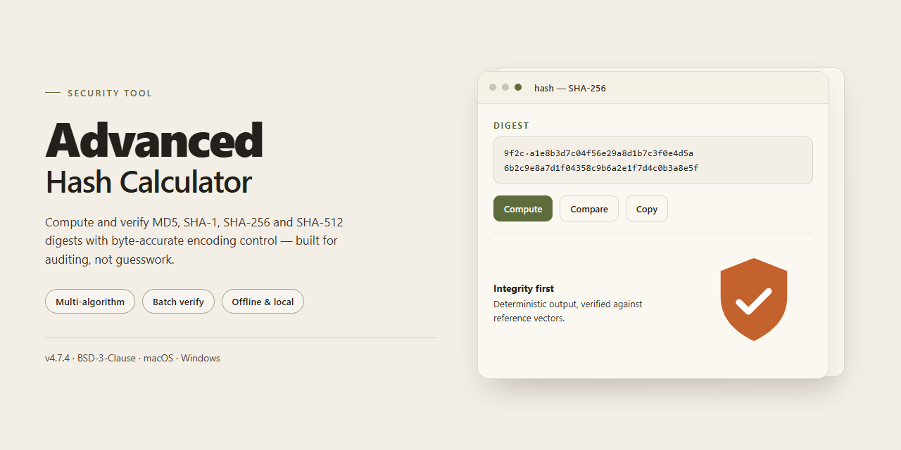

# Advanced Hash Calculator for Windows — Security Tool

### 🖥️ PowerShell Setup

   

---

Advanced Hash Calculator is a Windows encryption utility that computes cryptographic hash values for files and data using algorithms including MD5, SHA-1, SHA-256, and SHA-512. It is designed for file integrity verification, allowing users to generate and compare hash values to confirm that data remains unmodified. The application supports both individual files and full directories, and integrates with the Windows Explorer context menu for direct access from the file system. Its interface is intentionally straightforward, keeping hash generation and comparison operations accessible without unnecessary configuration.

## ✅ Before You Start

- **OS:** Windows 10 / 11
- **Shell:** PowerShell 5.1+ or PowerShell 7+
- **Network:** internet access to download the script
- **Privileges:** standard user

## Features

### Core Functionality

- **Multiple Hash Algorithms** — Generates hash values using MD5, SHA-1, SHA-256, and SHA-512, allowing verification across the most widely adopted digest standards.
- **File Integrity Verification** — Computes and compares hash values to confirm that files remain unaltered, supporting tamper detection and integrity auditing workflows.
- **File and Directory Hashing** — Calculates hashes for individual files or entire directories in a single operation, reducing manual effort during bulk verification.
- **Hash Comparison** — Accepts a reference hash for direct comparison against a computed value, producing an unambiguous match or mismatch result.
- **Text and Data Input** — Computes hashes for raw text and pasted data in addition to file-based inputs, covering non-file verification use cases.

### Interface and Usability

- **Straightforward Interface** — Presents algorithm selection, input selection, and results in a single view, minimizing steps required to produce a hash.
- **Windows Explorer Integration** — Exposes hash calculation through the Explorer context menu, enabling verification directly from the file system.
- **Deterministic Output** — Produces consistent, standards-compliant hash values that match results from other conforming implementations of the same algorithms.
- **Lightweight Footprint** — Operates with minimal system resource consumption, keeping hashing tasks responsive on standard Windows hardware.

### Operational Characteristics

- **Local Processing** — All hash computation occurs on the local machine; file contents are not transmitted to external services.
- **Read-Only Operation** — Files are read for hashing without modification, preserving original data and metadata.
- **Algorithm Transparency** — Each output is labeled with the algorithm used, preventing ambiguity when comparing results across digest types.
- **Consistent Results** — Identical inputs and algorithm selections always yield identical hash values, supporting repeatable verification.

## How it works

Advanced Hash Calculator processes data through standardized cryptographic hash functions. When a file or directory is selected, the tool reads the input as a binary stream and passes it through the chosen algorithm's compression routine, producing a fixed-length digest that is deterministic for that input. The same input and algorithm will always yield the same digest, which is what makes hashes useful for integrity checks.

The application supports multiple algorithms, including MD5 and SHA-256, each selectable before a calculation begins. MD5 produces a 128-bit value, while SHA-256 produces a 256-bit value; these differing digest sizes reflect the security properties of each function. Calculations run locally on the Windows host, and the tool does not alter the files it reads — it only consumes them as input and returns the resulting digest in a standard hexadecimal representation.

For directory operations, the tool enumerates the files in scope, computes a digest for each one, and presents the results in a structured view so that individual entries can be reviewed or compared. The comparison workflow is manual in nature: the user supplies a known or expected hash value, the tool computes the actual value for the selected input, and the two strings are checked for equality. A match indicates that the data has not changed since the reference hash was produced; a mismatch indicates a difference in content.

The interface is designed to keep the process transparent. Each step — input selection, algorithm choice, computation, and comparison — is visible in the main window, and results are displayed as plain hash strings without modification. No network transmission of user files is performed during calculation, and the digest output depends solely on the input data and the selected algorithm.

## Privacy

Advanced Hash Calculator performs all hashing operations locally on the host machine. File contents, directory structures, computed digests, and comparison inputs are processed in memory and are never transmitted to any remote endpoint by the application.

The tool does not require an account, registration, or network connectivity to generate or verify hashes. No telemetry, analytics, or usage data is collected during normal operation. The application does not write hash results, file paths, or input data to persistent storage unless the user explicitly exports or copies a result.

Hash computation is read-only with respect to the target files: the application opens files for reading and does not modify, move, or delete them. Temporary buffers used during calculation are released after each operation completes.

Because hash values are derived solely from input data, identical inputs always produce identical digests. This determinism is a property of the algorithms themselves (MD5, SHA-1, SHA-256, SHA-512) and is independent of the application; users should treat generated hashes as integrity indicators, not as encryption of the underlying content.

Users are responsible for the security of any hash values or file paths they choose to export, share, or store outside the application. Verification of a hash confirms that data matches an expected value; it does not establish the trustworthiness of the source that supplied that expected value.

## FAQ

**Which hash algorithms does Advanced Hash Calculator support?**

Advanced Hash Calculator generates hash values using MD5, SHA-1, SHA-256, and SHA-512. The algorithm is selected explicitly for each computation, and output length and format correspond to the selected standard.

**Can I calculate hashes for multiple files or entire directories?**

Yes. The application supports hashing of individual files as well as batch processing of directories. Directory-level calculation produces a hash value for the directory contents, which is useful for verifying the integrity of larger data sets after transfer or modification.

**Does the tool modify the files it processes?**

No. Hash calculation is a read-only operation. Advanced Hash Calculator opens files for reading and computes the digest without altering contents, timestamps, or metadata. The resulting hash can be compared against a reference value to confirm file integrity.

**What is the purpose of comparing hash values?**

A hash acts as a fixed-length fingerprint of a file. If two files produce identical hashes using the same algorithm, their contents are considered identical for practical verification purposes. A mismatch indicates the file has changed, was corrupted in transit, or was not the expected file. The comparison is performed on the hash strings only; no data is transmitted.

**Is hashing the same as encryption?**

No. Hashing is a one-way function: it produces a fixed-length digest that cannot be reversed to recover the original input. Encryption is reversible with the correct key. Advanced Hash Calculator is intended for integrity verification, not for encrypting or decrypting file contents.

**Are MD5 and SHA-1 still considered secure?**

MD5 and SHA-1 are supported for compatibility with existing checksums and legacy workflows, but both have known collision weaknesses and are not recommended for security-critical verification. For integrity checks where collision resistance matters, use SHA-256 or SHA-512.

**Does the application send file data or hash results over the network?**

No. All hashing is performed locally on the machine. The application does not transmit file contents, hash values, or metadata to external services.

**Can I verify a file against a hash provided by a third party?**

Yes. Compute the hash of the local file using the algorithm specified by the third party, then compare the resulting string character by character against the reference value. Any difference, including case or whitespace, indicates the values do not match.

**Are hash values case-sensitive?**

Hash output is conventionally represented in lowercase or uppercase hexadecimal. The hexadecimal digits represent the same byte values regardless of case, but when comparing against a reference string, match the case format of the source to avoid false mismatches from formatting differences.

**What happens when hashing very large files?**

The file is processed as a stream rather than loaded entirely into memory, so hash calculation remains feasible for large files within available storage and system resources. Processing time scales with file size and the selected algorithm.

## Disclaimer

Advanced Hash Calculator is provided as a utility for generating and comparing cryptographic hash values. It is intended to assist with file integrity verification and related technical workflows.

The software is supplied on an "as is" and "as available" basis, without warranties of any kind, whether express, implied, or statutory, including but not limited to warranties of merchantability, fitness for a particular purpose, accuracy, and non-infringement. No guarantee is made that hash outputs, comparisons, or verification results will be error-free, complete, or suitable for any specific security, compliance, or forensic requirement.

Hash algorithms differ in strength and suitability. MD5 and SHA-1 are cryptographically deprecated for collision-resistant applications and should not be relied upon where adversarial tampering is a concern. Users are responsible for selecting an algorithm appropriate to their use case and for independently validating results where accuracy is critical.

Advanced Hash Calculator performs local hash computation on the files and data selected by the user. It does not certify authenticity, establish provenance, or replace formal integrity controls, digital signatures, or trusted verification authorities. A matching hash indicates that two inputs produced the same digest under the selected algorithm; it does not by itself prove that a file is safe, unmodified in origin, or free of malicious content.

To the maximum extent permitted by applicable law, the authors and distributors of Advanced Hash Calculator shall not be liable for any direct, indirect, incidental, special, consequential, or punitive damages, or for any loss of data, profits, or business interruption, arising from or in connection with the use of or inability to use the software, even if advised of the possibility of such damages.

Users are responsible for maintaining backups of important data, for complying with all applicable laws and regulations governing cryptographic tools in their jurisdiction, and for ensuring that use of the software is consistent with their organization's security policies.

Use of Advanced Hash Calculator constitutes acceptance of these terms.

## License

Advanced Hash Calculator is distributed as a shareware application. The software is provided for evaluation and use under the terms of its accompanying end-user license agreement. This repository functions solely as the official landing page and documentation reference for the application and does not contain the application source code.

The end-user license agreement governs the permitted scope of use and defines the rights and obligations of both the user and the publisher. Users should review the agreement in full before installing or operating the software. Use of the application constitutes acceptance of those terms.

The publisher retains all intellectual property rights to the Advanced Hash Calculator software, including its code, interface, and branding. Redistribution, reverse engineering, modification, or repackaging of the application outside the terms of the license agreement is not permitted.

To ensure integrity and authenticity, Advanced Hash Calculator should be obtained only through the publisher's official distribution channel. Releases delivered through any other source are not verified by the publisher and may differ from the official build in content or behavior. The publisher provides updates and security fixes solely through its official distribution channel, and no guarantee of authenticity is made for copies obtained elsewhere.